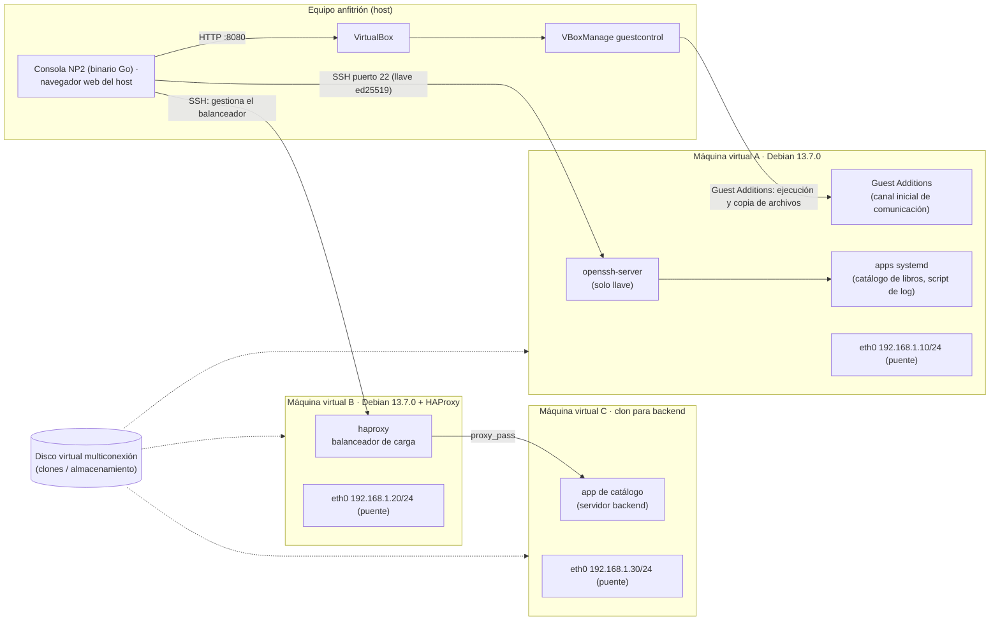

# Escenario de aplicación

Diagrama del escenario utilizado para desarrollar y probar la solución.

## Descripción

- **Equipo anfitrión y virtualización.** El desarrollo se realiza en un equipo
  anfitrión con software de virtualización. Las máquinas invitadas usan adaptador
  de red en **modo puente**, de modo que cada una tiene su propia dirección IP en
  la red local y es alcanzable desde el host.

- **Máquina virtual A (gestión).** Debian 13.7.0 actualizado, con `openssh-server`
  instalado. Es el objeto principal de la automatización: la consola instala y
  elimina paquetes, configura el acceso SSH de `root`, personaliza el banner,
  fija el nombre de host, administra usuarios y despliega aplicaciones como
  servicios de systemd.

- **Máquinas virtuales B y C (balanceo).** La máquina B ejecuta **HAProxy** con
  su configuración predeterminada; la máquina C (y los clones del disco
  multiconexión) hospedan la aplicación de catálogo de libros que actúa como
  servidor del backend. La consola agrega y elimina servidores del backend de
  HAProxy y recarga el balanceador.

- **Discos.** El disco virtual **multiconexión** permite crear clones listos para
  usar, de forma que se puedan añadir varios servidores al backend del
  balanceador sin reinstalar el sistema operativo.

- **Mecanismo de comunicación.** El binario de la consola se ejecuta en el
  **host**; el navegador del host abre la interfaz web. La comunicación con la
  máquina virtual comienza por el canal de las **Guest Additions**, que la
  consola usa desde el host mediante `VBoxManage guestcontrol` (`-mode
  guestcontrol`). Una vez generadas las llaves, toda la comunicación con la
  máquina virtual pasa a ser **exclusivamente por SSH y autenticada por llave**
  (`-mode ssh`); el inicio de sesión por contraseña queda deshabilitado. El modo
  **`auto`** intenta SSH y, si no hay conexión, vuelve automáticamente a las
  Guest Additions. También es posible ejecutar la consola dentro del invitado
  (`-mode local`).

- **Flujo general de la automatización.**

  1. El usuario abre la consola en el navegador del host.
  2. Rellena un formulario del módulo correspondiente.
  3. La consola valida los datos; si son inválidos, no se ejecuta nada.
  4. La operación se traduce en comandos *argv* que viajan por el transporte
     activo (Guest Additions o SSH).
  5. La consola recopila el resultado y muestra el informe: estado global,
     resumen, notas, advertencias y la información técnica
     (comando, código de salida, `stdout`, `stderr`).
  6. Si la operación generó archivos (por ejemplo la llave privada SSH), se
     ofrecen como descarga.
